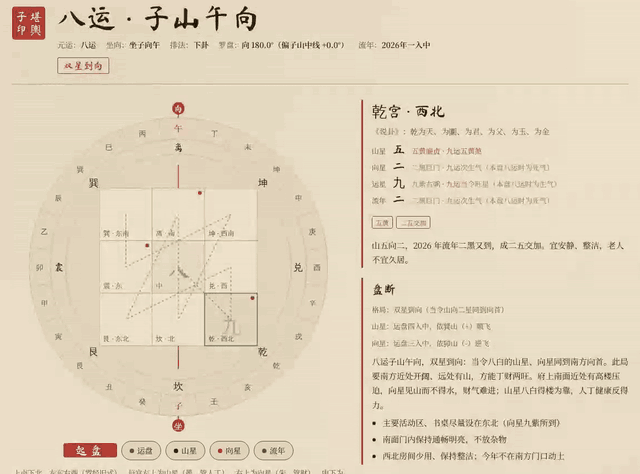
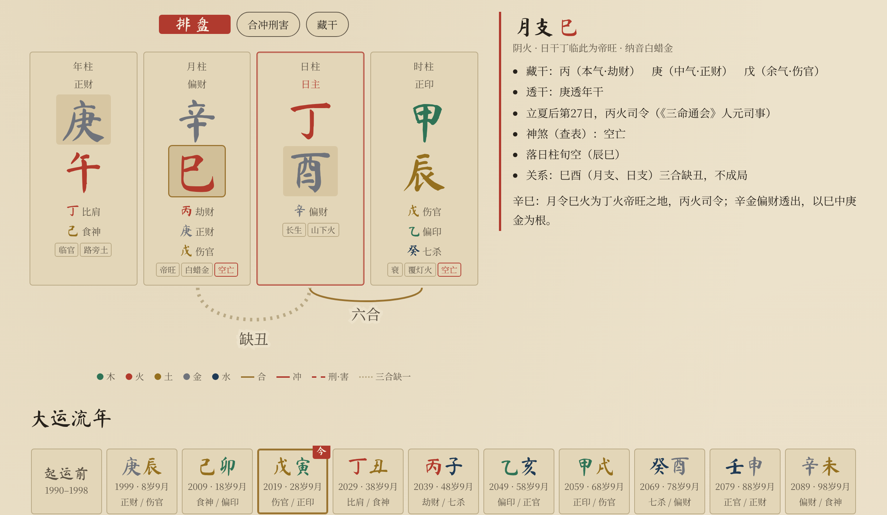
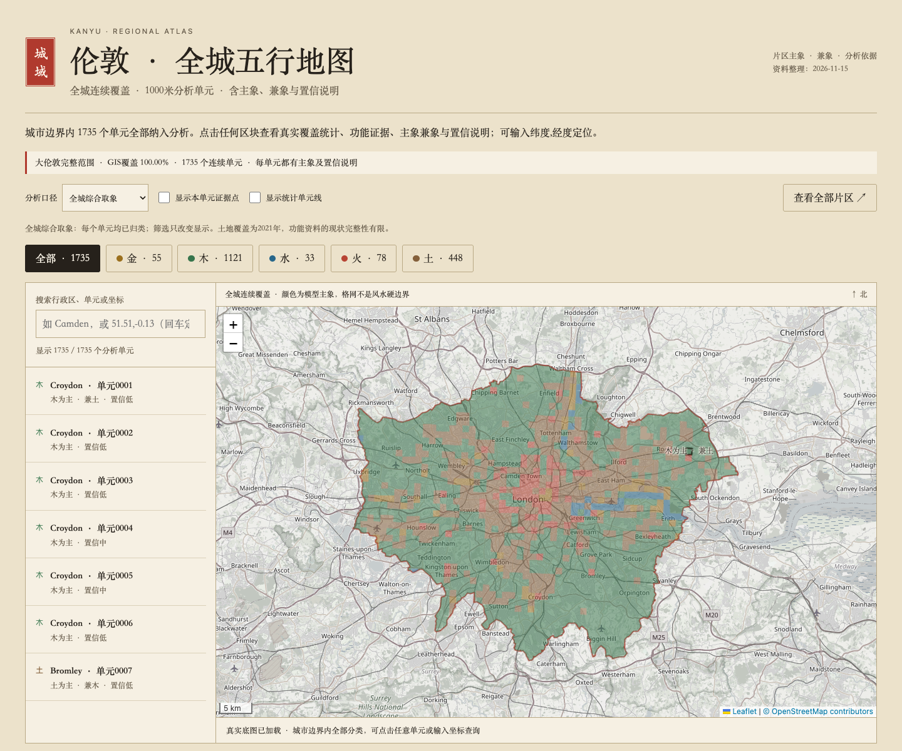

# Kanyuzi · Traditional Feng Shui and Bazi Advisor

[中文](README.md) · **English**

[](https://github.com/voidforall/fengshui.skill/actions/workflows/tests.yml)
[](https://github.com/voidforall/fengshui.skill/releases)
[](https://agentskills.io)
[](LICENSE)

**Turn your AI agent into a traditional advisor on Flying Stars, Eight Mansions, date selection and Bazi.**
Code casts the charts, the model explains them, and every claim can be traced to a source. Works in Claude Code,
Codex CLI and 30+ other agents that support [Agent Skills](https://agentskills.io).

<p align="center">
  
</p>

## What it does

| | Ask something like | You get |
|---|---|---|
| **Home** | "My flat sits north and faces south, we moved in in 2018, money has been tight. Can you take a look?" | Flying Star chart, Eight Mansions directions, layout advice and an interactive chart you can cast |
| **Dates** | "I'm moving in June. Pick a good day; I'm a man born in 1988 and the door faces east." | Candidate days with Month Breaker and personal clashes excluded, and the reasons |
| **Bazi** | "Born 1 June 1990, 8:30 am in Beijing, female. Which element am I missing? How is this year?" | Plain English first, then the technical reading, and an interactive chart anyone can follow |
| **City map** | "Make a Five Elements map of London." | A map coloured across the whole declared area, with reasons, sources and confidence for every cell |
| **Questions** | "What does 'the mountain dragon does not go down to the water' mean?" | An explanation that quotes the original and names the source |

Ask in English and the agent answers in English, with terms from a single bilingual glossary
(English first, pinyin and Chinese characters at first mention), and generates the charts and maps in English.
Where a term has a standard English rendering (WHO, the Key Concepts in Chinese Thought and Culture project), that is the one used.

## Install

```bash
npx skills add voidforall/fengshui.skill --skill fengshui-master   # Feng shui: home, dates, questions
npx skills add voidforall/fengshui.skill --skill bazi-mingli       # Bazi
npx skills add voidforall/fengshui.skill --skill city-wuxing-map   # City Five Elements map
```

Without `--skill` you are shown the three skills to choose from (`--skill '*'` installs all). Then just ask in plain
language; there are no commands to remember.

## Examples

<table>
  <tr>
    <td width="50%"><a href="docs/examples/bazi-demo.en.html"></a></td>
    <td width="50%"><a href="docs/examples/london-wuxing.en.html"></a></td>
  </tr>
  <tr>
    <td align="center"><b>Bazi chart</b>: plain summary first; tap any term for an explanation</td>
    <td align="center"><b>City Five Elements map</b>: <a href="docs/examples/london-wuxing.en.html">London</a> and <a href="docs/examples/new-york-wuxing.en.html">New York</a>, whole city</td>
  </tr>
</table>

English examples: [Flying Star chart](docs/examples/feixing-demo.en.html) · [Bazi chart](docs/examples/bazi-demo.en.html) ·
[London](docs/examples/london-wuxing.en.html) · [New York](docs/examples/new-york-wuxing.en.html).
(The screenshots above show the Chinese pages.) Every chart is a single HTML file that works offline, on phones and in dark mode.

## Why you can trust it

- **Code computes, the model interprets.** Language models are bad at casting charts and working out solar terms, and
  those mistakes look right, which makes them hard to catch. All charts, calendars and table lookups are done by
  deterministic scripts with regression tests.
- **Claims need sources.** Every rule and quotation carries its source and how far it has been checked; common practice
  is never passed off as classical text.
- **No fear, no trinkets.** Feng shui supports, people decide. It speaks of tendencies, never of fate.

How it works: [How it works](docs/how-it-works.en.md).

## Classical sources

| Area | Texts |
|------|------|
| Feng shui | Zhai Jing 宅经, Zang Shu 葬书, Qing Nang Xu 青囊序, Tian Yu Jing 天玉经, Han Long Jing 撼龙经, Shuo Gua 说卦 of the Book of Changes, Shen Shi Xuan Kong Xue 沈氏玄空学, Ba Zhai Ming Jing 八宅明镜, Xie Ji Bian Fang Shu 协纪辨方书, Di Li Wu Jue 地理五诀, Zi Bai Jue 紫白诀 |
| City Five Elements | Hong Fan 洪范 of the Book of History, Wu Xing Da Yi 五行大义 |
| Bazi | San Ming Tong Hui 三命通会, Yuan Hai Zi Ping 渊海子平, Qiong Tong Bao Jian 穷通宝鉴, Di Tian Sui Chan Wei 滴天髓阐微, Wu Xing Da Yi 五行大义 |

## Roadmap

- [x] Flying Star chart: 24-Mountain compass, stars flying palace by palace, notes per palace
- [x] Bazi chart: plain summary, term explanations, combinations and clashes, Luck Pillars and years
- [x] City Five Elements maps: London and New York, central Shanghai
- [x] English: answers, charts and maps
- [ ] Compass: point the phone at the front door and read the facing live
- [ ] Floor plan: drag rooms onto the nine palaces
- [ ] Date-selection calendar, Eight Mansions direction chart, divination

## Docs

- Rules and workflow of each skill: [fengshui-master](skills/fengshui-master/SKILL.md) · [bazi-mingli](skills/bazi-mingli/SKILL.md) · [city-wuxing-map](skills/city-wuxing-map/SKILL.md) (written in Chinese; English answering rules in each skill's `references/english.md`)
- English glossaries: [feng shui](skills/fengshui-master/references/terms-en.md) · [Bazi](skills/bazi-mingli/references/terms-en.md)
- [How it works](docs/how-it-works.en.md) · [Contributing](CONTRIBUTING.md) (Chinese) · [Changelog](CHANGELOG.md) (Chinese)
- Found a mistake? Please open an issue and cite the source (the text and chapter, or another checkable reference).

## License

Code and docs are released under [MIT](LICENSE). Third-party data used by the city maps and Leaflet keep their own
licences; see the [data sources](skills/city-wuxing-map/examples/sources/README.md).

## Disclaimer

This project is based on classical texts of traditional feng shui and Chinese astrology, for learning, reference and
cultural discussion. For major decisions about your home or your life, weigh your actual circumstances; do not rely on
this alone.

## Star History

<a href="https://www.star-history.com/#voidforall/fengshui.skill&Date">
  <picture>
    <source media="(prefers-color-scheme: dark)" srcset="https://api.star-history.com/svg?repos=voidforall/fengshui.skill&type=Date&theme=dark" />
    <source media="(prefers-color-scheme: light)" srcset="https://api.star-history.com/svg?repos=voidforall/fengshui.skill&type=Date" />
    
  </picture>
</a>
