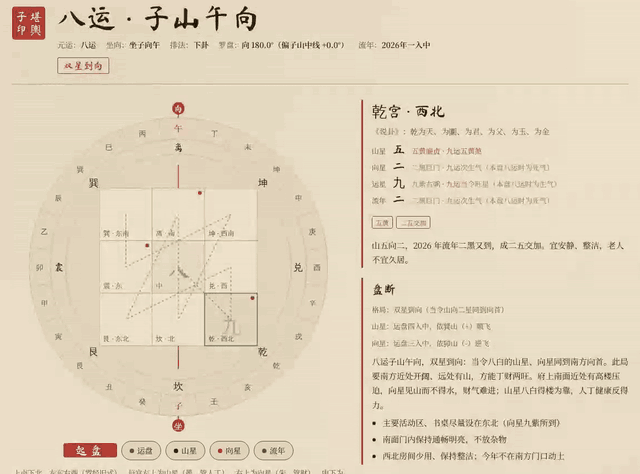
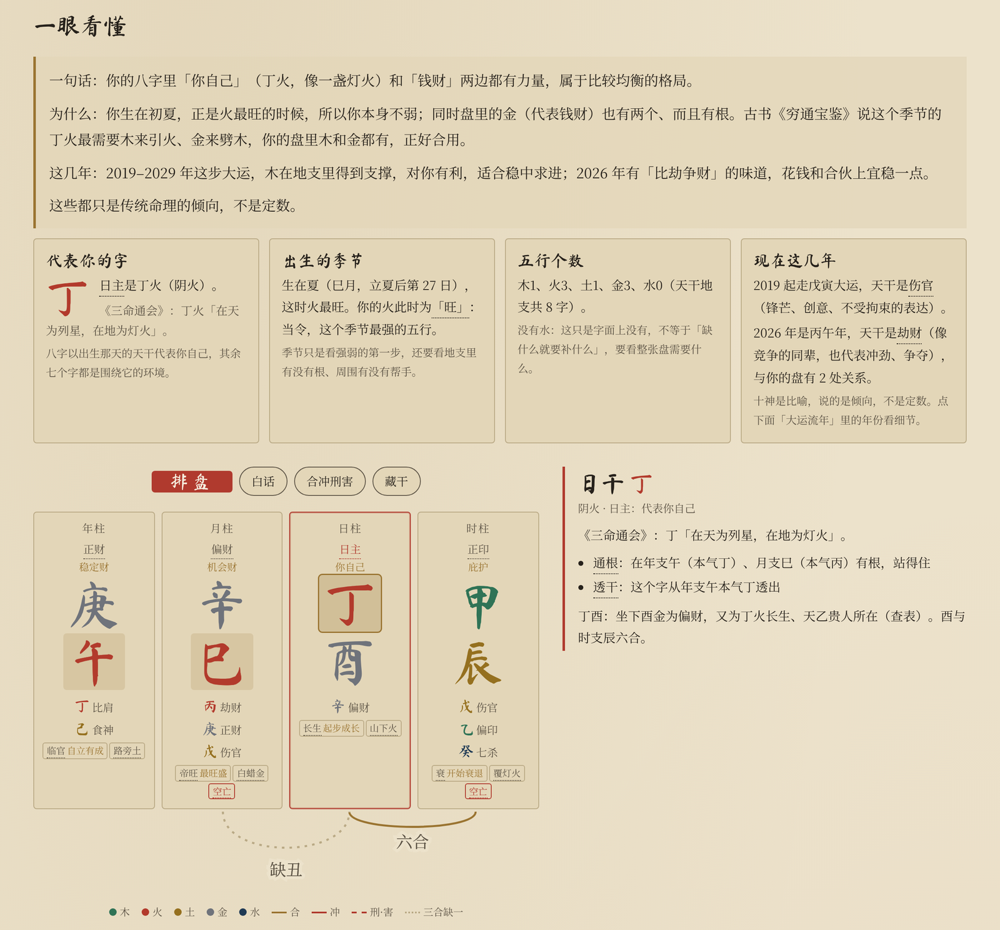
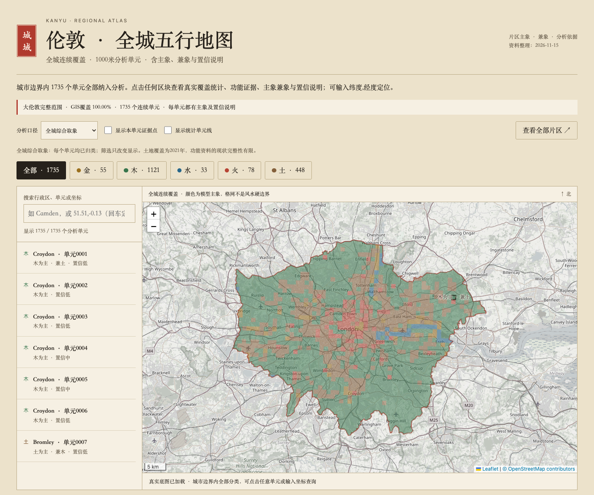

# 堪舆子 · 传统风水顾问

> 「峦头为体，理气为用。」（堪舆家常言）

**一个遵循 [Agent Skills 开放标准](https://agentskills.io) 的 Skill，将传统堪舆学蒸馏为可对话的风水顾问。** 运用玄空飞星、八宅明镜、择日学等传统方法，帮助你分析居住环境、选择吉日、化解煞气。

本 Skill 由一份符合标准的 `SKILL.md`、参考资料和一个确定性计算脚本组成，不绑定任何特定工具——可在 Claude Code、Codex CLI 等 30+ 支持 [Agent Skills](https://github.com/agentskills/agentskills) 标准的智能体中直接使用。

<p align="center">
  
</p>

**每次排盘，都会给你一张可以「起盘」的交互盘面。** 九星按洛书轨迹逐宫飞布，点任意一宫，看《说卦》取象、各星旺衰与这一宫的批注。
单个 HTML 文件，离线可开，手机与深色模式都能看。

---

## 这是什么

传统风水（堪舆学）是一套研究居住环境与人居关系的学问，包含形势（地理格局）与理气（方位气场）两大体系。本 Skill 将其核心方法论编码为 AI 智能体可执行的知识框架，使其能够：

- 根据房屋朝向、入住时间，**排布玄空飞星盘**，判断旺位凶位
- 依据居住者命卦，**配合八宅游年**，给出四吉四凶方布局建议
- 结合年月神煞，**筛选入宅/开业/动土吉日**，给出可操作时间窗口
- **排八字**：自动处理夏令时、真太阳时、子时换日与海外时区；给出藏干十神、通根透干、合冲刑害、《穷通宝鉴》调候原文与大运流年，生成可交互的命盘
- 识别路冲、天斩、壁刀等**常见外煞**，提供化解方案
- **解读风水术语**与经典原文，回答堪舆学理论问题
- 使用独立的 **city-wuxing-map** skill，生成城市的**金木水火土区域地图**，点击色块查阅主象、兼象、划界依据与分析原因

**计算交给代码，解读交给模型。** 大模型擅长问询与解释，但并不擅长排盘、推算干支节气——这些地方「看起来对」的错误最难被发现。因此本 Skill 内置 `scripts/fengshui.py`，所有排盘、查表、历法计算由脚本确定性完成，并有回归测试覆盖；模型只负责收集信息、调用脚本、解读结果。

不是玄学算命，不卖风水摆件，不恐吓煞气。基于《沈氏玄空学》《地理五诀》《协纪辨方书》等传统典籍的系统性方法。

---

## 安装

```bash
npx skills add voidforall/fengshui.skill
```

仓库另含两个独立 skill，可单独安装（主顾问可用 `--skill fengshui-master` 指定）：

```bash
npx skills add voidforall/fengshui.skill --full-depth --skill bazi-mingli        # 子平八字
npx skills add voidforall/fengshui.skill --full-depth --skill city-wuxing-map    # 城市五行地图
```

| skill | 用途 |
|-------|------|
| `fengshui-master`（仓库根目录） | 看宅、飞星、八宅、择日、煞气、风水问答 |
| [`bazi-mingli`](skills/bazi-mingli/SKILL.md) | 排八字、五行喜用、大运流年、交互命盘 |
| [`city-wuxing-map`](skills/city-wuxing-map/SKILL.md) | 城市全域五行地图 |

---

## 使用方法

安装后，在支持该 Skill 的智能体（Claude Code、Codex CLI 等）中用自然语言描述需求即可触发。**无需特定指令**，以下场景均能自动识别：

### 阳宅分析

```
我家坐北朝南，2018年入住，最近财运不好，帮我看看风水格局
```

```
新家东南朝向，想知道主卧应该放在哪个方位，我是1990年的男性
```

### 择日

```
打算今年6月搬新家，帮我选几个入宅吉日，我是1988年男，门朝东
```

```
公司9月份想开业，什么日子比较好？
```

### 煞气与化解

```
我家大门正对着一条笔直的道路，这算不算路冲？怎么化解？
```

### 八字（bazi-mingli）

```
我是1990年6月1日早上8点半在北京出生的女生，帮我看看八字，五行缺什么？今年运势怎么样？
```

```
农历八五年冬月初九晚上十一点半出生，男，在纽约出生，喜用神是什么？
```

<p align="center">
  
</p>

**排了八字就有一张交互命盘**（[示例](docs/examples/bazi-demo.html)），不懂命理也看得懂：
页面最上方「一眼看懂」先用白话讲结论，再给代表你的字（附《三命通会》物象）、出生季节的强弱、五行个数和这几年的大运流年；
命盘上每个术语都能点开看白话解释，「白话」开关在十神、长生旁标出一词释义，页尾有术语表。
想深入的，四柱依次翻开，柱间弧线标出合冲刑害，点任一干支看通根、透干、藏干；大运流年可点选或拖动到任一年。
回答也是先白话、后专业：旺衰、用神是模型的解读，以批注写入页面，并注明所依流派。

### 风水问答

```
八宅游年是什么？怎么算命卦？
```

```
九运是从哪年开始的？对风水布局有什么影响？
```

```
《青囊序》里「山上龙神不下水」是什么意思？
```

### 城市全域五行地图

```
给伦敦做完整城市范围的五行着色地图，每个地方都有主象、兼象和原因，
能切换土地覆盖底层与综合分析，说明资料年代和置信等级。
```

独立skill [city-wuxing-map](skills/city-wuxing-map/SKILL.md) 在真实底图上连续着色，点击任意单元查看覆盖统计、功能证据、主象、兼象、置信等级和来源。支持当地邮编/地址定位（伦敦完整邮编及邮区、纽约ZIP Code）、候选地点选择、坐标定位、行政区搜索、五行筛选及可选证据点和格网线。



| 示例 | 完整范围与分区 | 文件 |
|---|---|---|
| 伦敦 | 大伦敦完整范围，1,735个单元 | [交互地图](docs/examples/london-wuxing.html) · [JSON](skills/city-wuxing-map/examples/london.json) |
| 纽约 | 五区完整范围（含行政水域），1,323个单元 | [交互地图](docs/examples/new-york-wuxing.html) · [JSON](skills/city-wuxing-map/examples/new-york.json) |

采用1km统计格网裁切真实城市边界，两城均经拓扑校验达到完整覆盖，无面积空洞和重叠（浮点容差内）。每个单元在两种口径下都有分类；统计格网不代表天然风水边界。土地覆盖来自2021年WorldCover，在50m汇总栅格上统计；伦敦功能来自2026-11-15 OSM快照，纽约采用当日取得的DCP许可规划分区与演艺区研究，规划不等于现状。

颜色是公开的现代解释模型，并非客观测量的固有五行。证据较弱的地方仍给出模型分类，同时显示低置信等级及局限；不虚构五行能量百分比。规则见[分析方法](skills/city-wuxing-map/references/method.md)，冻结数据、许可和哈希见[数据源](skills/city-wuxing-map/examples/sources/README.md)。

从仓库根目录运行：

```bash
python3 -m pip install -r skills/city-wuxing-map/requirements.txt
python3 skills/city-wuxing-map/scripts/generate.py --example london --output docs/examples/london-wuxing.html
python3 skills/city-wuxing-map/scripts/generate.py --example new-york --output docs/examples/new-york-wuxing.html
python3 -m http.server 8000 --bind 127.0.0.1
# 打开 http://127.0.0.1:8000/docs/examples/london-wuxing.html
```

真实瓦片需要联网和HTTP，Leaflet已内嵌；GitHub文件预览不运行交互地图。其他城市按[全城数据格式](skills/city-wuxing-map/references/data-format.md)提供完整边界和连续分区；旧版点位和局部片区输入会被拒绝。离线源数据重建命令见skill说明。

---

## 可视化路线图

不同的问题用不同的盘面。数据一律由脚本计算，模型只往页面里填解读文字。

| 用例 | 交互 | 状态 |
|------|------|------|
| **飞星揭盘** | 二十四山罗盘 + 九宫；「起盘」按洛书逐宫飞布；分层看运盘、山星、向星、流年；点宫看批注 | ✅ 已上线 |
| **城市五行地图** | 真实底图 + 片区着色；主象/兼象、分析口径切换、划界依据与可选证据层；伦敦与纽约示例 | ✅ 独立 skill 已上线 |
| **罗盘定向** | 拖动罗盘，或在手机上用陀螺仪对准大门，实时显示坐向、兼向度数、是否空亡 | 计划中 |
| **户型对位** | 把「大门、主卧、厨房」卡片拖到九宫方位，逐个房间显示飞星与八宅吉凶 | 计划中 |
| **八宅方位** | 八个扇区按吉凶着色，叠加家人命卦外环，宅命配不配一眼可见 | 计划中 |
| **择日月历** | 黄历式月历：吉日亮、凶日暗，悬停看建除、神煞与排除原因 | 计划中 |
| **八字命盘** | 四柱依次翻开；柱间弧线标合冲刑害；点干支看通根透干；大运流年可拖动；《穷通宝鉴》调候原文。五行只给个数，不做「力量」打分 | ✅ 已上线 |
| **起卦** | 摇三枚铜钱六次成卦，揭示本卦、变卦与《周易》卦辞（原文出处见 `references/sources.md`） | 计划中 |

---

## 知识体系

| 流派 | 核心方法 | 用途 |
|------|---------|------|
| **三元玄空飞星** | 九宫飞布、元运、山星向星 | 阳宅旺衰、财运人丁判断 |
| **八宅明镜** | 东西四宅命、游年变卦 | 卧室书房财位布局 |
| **形势峦头** | 龙穴砂水向、藏风聚气 | 外部环境与煞气判断 |
| **择日学** | 建除十二神、月破三煞 | 入宅开业动土选日 |
| **八字配风水** | 日主用神、五行方位 | 个人旺方与颜色建议 |

---

## 计算脚本

Skill 运行时会自动调用，也可以直接在命令行使用：

```bash
python3 scripts/fengshui.py feixing --facing 180 --year 2018-09 --annual 2026   # 玄空飞星排盘
python3 scripts/fengshui.py feixing --facing 180 --year 2018-09 --annual 2026 \
        --html 飞星盘.html --notes 批注.json                                         # 同时生成交互盘面
python3 scripts/fengshui.py bazhai --facing 90 --birth 1988-05-01 --gender m    # 八宅游年 + 命卦
python3 scripts/fengshui.py mingua --birth 1990-01-20 --gender f                # 命卦（自动按立春分年）
python3 scripts/fengshui.py liunian --year 2026 --span 5                        # 流年紫白、太岁、三煞
python3 scripts/fengshui.py day --date 2026-05-20                               # 单日四柱、建除、神煞、宜忌
python3 scripts/fengshui.py zeri --event 入宅 --start 2026-05-10 --end 2026-05-31 --birth-year 1988

# 八字（bazi-mingli skill 的入口）
python3 skills/bazi-mingli/scripts/bazi.py --birth "1990-06-01 08:30" --gender f --longitude 116.4 \
        --year 2026 --html 命盘.html --notes 批注.json                                # 八字 + 交互命盘
python3 skills/bazi-mingli/scripts/bazi.py --birth "1985-11-09 23:30" --lunar --gender m \
        --tz America/New_York --longitude -74.0                                   # 农历输入、海外出生
python3 skills/bazi-mingli/scripts/bazi.py --birth 1985-12-20 --gender m           # 时辰不详：排三柱
```

计算包只有一份源头：根目录 `scripts/kanyu/`。`bazi-mingli` 安装后是独立目录，随 skill 带一份副本；
修改 `scripts/kanyu/` 后运行 `python3 tools/sync_kanyu.py` 同步，`tests/test_skill_bazi.py` 检查两边一致。

每个命令都可以加 `--json` 输出结构化数据，便于程序处理。

| 计算 | 实现 |
|------|------|
| 飞星排盘 | 二十四山玄空阴阳 + 同元龙定顺逆，支持替卦、兼向/空亡提示、格局判定（旺山旺向、上山下水、双星、伏反吟、合十、三般卦） |
| 八宅 | 依《八宅明镜》游年歌诀生成，命卦自动按立春分年、男五寄坤女五寄艮 |
| 流年流月 | 紫白飞星、太岁、岁破、三煞、五黄二黑方 |
| 八字 | 年柱以立春、月柱以节为界（按同一时刻的北京时间比对节气）；日柱、时柱用出生地真太阳时；按 IANA 时区自动扣夏令时；子时默认 23:00 换日，并列出晚子时一说。藏干十神、十二长生、人元司事、合冲刑害、禄刃贵人驿马咸池空亡依《三命通会》查表；调候按日干、节气月检出《穷通宝鉴》原文（120 格）。不判定旺衰、用神 |
| 历法择日 | 干支、节气、建除、黄黑道、神煞、宜忌取自 lunar-python；月破、正四废、冲当事人做硬排除；岁破日、受死为通书俗忌，只标注 |

### 测试

```bash
python3 -m unittest discover -s tests
```

未安装 `lunar_python` 时，历法相关用例会自动跳过。CI 在 Python 3.10 / 3.13、装与不装 lunar_python 四种组合下运行。

命令行输出有快照测试（`tests/golden/`）。有意修改输出格式后，重新生成快照并检查 diff：

```bash
UPDATE_GOLDEN=1 python3 -m unittest tests/test_cli.py
git diff tests/golden/
```

测试用例取自可公开核对的结论（游年歌诀、七/八/九运旺山旺向与上山下水表、紫白年星与 lunar-python 交叉验证等）。派别有分歧的地方不进测试，而是在输出中提示。

### 版本

变更记录见 [CHANGELOG.md](CHANGELOG.md)。v1.0.0 的八宅、命卦、飞星规则存在大量错误，已在 v2.0.0 修正，请使用 v2 及以上版本。

**发版**：在一个 PR 里同步提升 `scripts/kanyu/__init__.py` 与 `SKILL.md` 的版本号，并把 CHANGELOG 的 `## [Unreleased]` 改为 `## [版本号] - 日期`。
合并到 main 后，`.github/workflows/release.yml` 自动打 tag、以 CHANGELOG 对应条目为正文发布 GitHub Release（tag 已存在则跳过）。

### 出处

每条规则、引文的出处与核对状态都列在 [references/sources.md](references/sources.md)，分为：原文已核对、已计算验证、公认出处（原文未核对）、流派口径、已删除。
SKILL 要求模型按状态说话，不把通行做法说成经典原文。

### 勘误

发现错误？欢迎提 issue，请注明**出处**（典籍卷次或可核对的资料）。确认后会补充对应的测试用例。

---

## 文件结构

```
fengshui.skill/
├── SKILL.md                    # 主 Skill：铁律、人设、问题分流（按用例路由到 references/playbook-*.md）
├── scripts/
│   ├── fengshui.py             # 命令行入口（SKILL 调用这里）
│   └── kanyu/                  # 确定性计算包
│       ├── core.py             #   二十四山、九宫、洛书飞泊、元运（纯标准库）
│       ├── bazhai.py           #   八宅：命卦、游年
│       ├── feixing.py          #   玄空飞星：排盘、格局、替卦、兼向
│       ├── zibai.py            #   流年流月紫白、年家煞方
│       ├── almanac.py          #   历法：立春分年、节气月、单日信息、真太阳时
│       ├── zeri.py             #   择日：硬排除规则 + 打分
│       ├── bazi.py             #   八字排盘：时间口径、四柱、通根透干、大运流年
│       ├── ganzhi.py           #   干支查表：十神、藏干、长生、司令、合冲刑害、神煞、旬空（纯标准库）
│       ├── data/qiongtong.json #   《穷通宝鉴》日干 × 月令调候原文索引
│       ├── render.py           #   文字输出（计算模块不做格式化）
│       ├── pages.py            #   交互 HTML 盘面（模板在各 skill 的 assets/templates/）
│       └── cli.py              #   参数解析、--json
├── tests/
│   ├── test_<模块>.py          # 每个模块一份单元测试
│   ├── test_cli.py             # 命令行快照、JSON、出错路径
│   └── golden/                 # 命令行输出快照
├── CHANGELOG.md                # 变更记录
├── requirements.txt            # lunar_python（历法）
├── references/
│   ├── playbook-yangzhai.md    # 看宅流程（含交互盘面）
│   ├── playbook-zeri.md        # 择日流程
│   ├── feixing.md              # 玄空飞星速查（九宫飞布规则、各运旺衰、流年星表）
│   ├── wuxing-ganzhi.md        # 五行干支速查（天干地支、生克、命卦算法）
│   ├── zeri.md                 # 择日规则（节气月、大忌、通书俗忌、年神方位）
│   └── sources.md              # 每条规则 / 引文的出处与核对状态
├── assets/
│   └── templates/              # 交互盘面模板
├── skills/
│   ├── bazi-mingli/            # 独立八字 skill：SKILL、流程与出处、命盘模板、入口 scripts/bazi.py、kanyu 副本
│   └── city-wuxing-map/        # 独立城市五行地图 skill：生成器、模板、示例与取象口径
├── tools/
│   └── sync_kanyu.py           # 把 scripts/kanyu/ 同步到 skills/bazi-mingli/scripts/kanyu/
├── docs/
│   ├── images/                 # README 用图
│   └── examples/               # 交互盘面示例
└── examples/
    ├── yangzhai.md             # 完整阳宅分析对话示例（含飞星盘排布过程）
    └── zeri-example.md         # 完整择日对话示例（含命卦配合）
```

---

## 人物设定

**堪舆子**：研习传统堪舆的顾问。主修玄空飞星，兼通八宅明镜与形势峦头，择日参《协纪辨方书》体系。不虚构师承身份。

风格：引经据典但解释清晰，先问情况再下结论，不夸大风水作用，对伪术直接指出。

> 「《宅经》引《三元经》云：地善即苗茂，宅吉即人荣。风水能提供有利条件，左右吉凶概率，非决定命运之术。」

---

## 参考典籍

- 《宅经》（黄帝宅经）
- 《葬书》（郭璞）
- 《天玉经》《青囊序》（杨筠松）
- 《地理五诀》（赵九峰）
- 《玄空秘旨》
- 《沈氏玄空学》（沈竹礽）
- 《协纪辨方书》（清·允禄等）

---

## 相关项目

本项目遵循 **Agent Skills 开放标准**，也属于 **Persona Distill Skill** 生态的一部分——将特定领域的知识体系与专家视角蒸馏为跨工具可复用的 Skill。

- [agentskills/agentskills](https://github.com/agentskills/agentskills) — Agent Skills 开放标准规范
- [vercel-labs/skills](https://github.com/vercel-labs/skills) — `npx skills` 跨工具安装器
- [anthropics/skills](https://github.com/anthropics/skills) — 官方 Skill 仓库
- [nuwa-skill](https://github.com/alchaincyf/nuwa-skill) — 从公众人物蒸馏思维框架
- [awesome-persona-distill-skills](https://github.com/xixu-me/awesome-persona-distill-skills) — Persona Skill 合集

---

## 免责声明

本项目基于传统堪舆学理论，仅供学习、参考与文化探讨。风水为辅，人为为主。重大居住与人生决策请结合实际情况综合考量，勿作为唯一依据。
